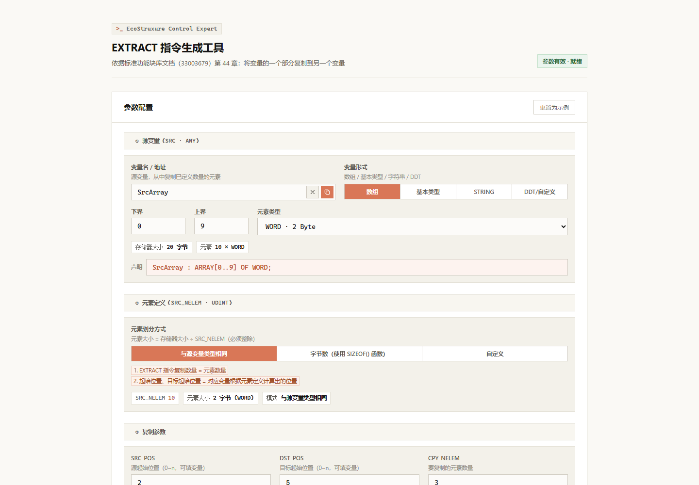
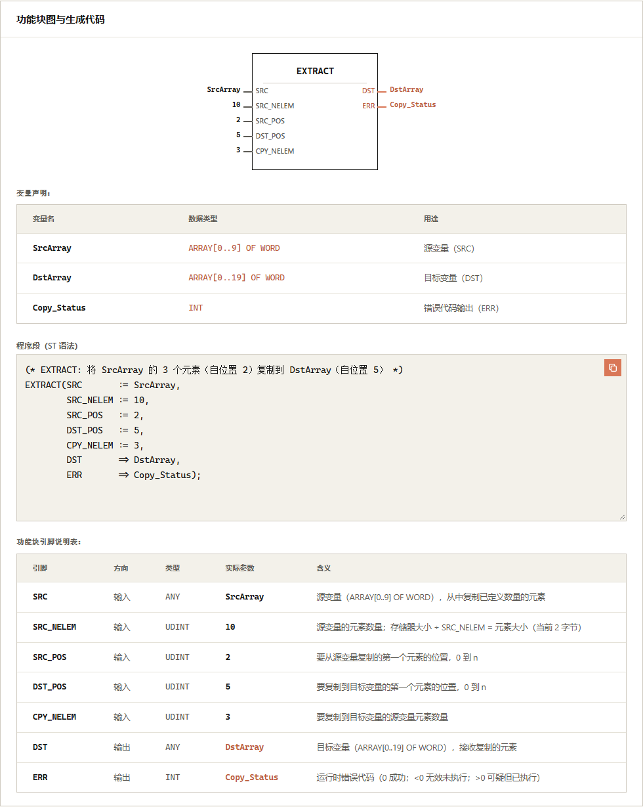
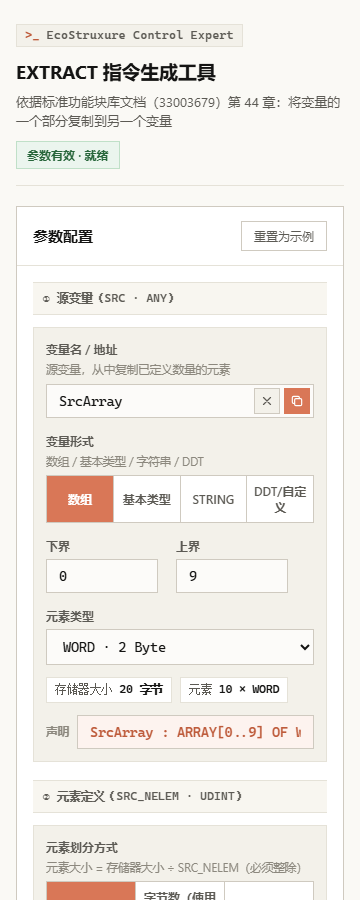

# M580-EXTRACT-CMD-HELPER

> 语言 / Language：[中文](#中文) · [English](#english)

仓库 `M580-EXTRACT-CMD-HELPER`：<https://github.com/lilixxs/M580-EXTRACT-CMD-HELPER>

---

# 中文

## 这是什么

`INDEX.html` 是一个 **EXTRACT 指令生成工具**：填写源变量、目标变量、位置和复制数量，页面给出参数校验、功能块图、变量声明表、复制数据示意图、引脚说明表，并生成 ST 程序段。

`ADDMX地址生成解析工具.docx` 记录的是 ADDM/ADDMX 寻址工具的需求演变。当前页面**不是**该工具，两者差异是有意保留的现状。

## 界面截图

默认参数下的页头与参数配置区（桌面视口 1440×1000）：



默认参数下的功能块图、变量声明、ST 程序段与引脚说明表区域（桌面输出区域的元素截图；视口 1440×1000，PNG 980×1229）：



窄屏（移动视口 360×900）下的页头与参数配置区：



以上截图在浏览器中直接打开当前 `INDEX.html` 默认示例拍摄，来自 UI 提交 `585e78e`，界面为中文。截图为说明材料，不是视觉测试基线。

## 功能要点

- 源/目标变量支持四种形式：数组、基本类型、STRING、DDT/自定义。
- 元素划分（SRC_NELEM）三种方式：与源变量类型相同、字节数（`SIZEOF()` 函数）、自定义值。
- `SRC_POS` / `DST_POS` 是**从 0 开始的元素偏移**，不是数组声明下标。例如 `ARRAY[5..14]` 中 `SRC_POS = 2` 对应下标 7。
- 目标容量按「目标字节数 ÷ 元素大小」计算，不一定等于目标数组的元素数。
- `SRC_POS`、`DST_POS`、`CPY_NELEM` 支持填入变量名等非整数文本，按运行时表达式处理并原样写入 ST。
- 实时输出：参数校验（对应 ERR 运行时错误预判）、功能块图、变量声明表、复制数据示意图、引脚说明表、ST 程序段。
- 源变量名、目标变量名、ERR 变量名三个字段提供复制与清空按钮；程序段有复制按钮；「重置为示例」恢复默认参数。

## 使用步骤

1. 浏览器直接打开 `INDEX.html`（单文件、离线可用，无需 npm 或外网）。
2. ①④ 填写源变量与目标变量的名称/地址及变量形式。
3. ② 选择元素划分方式，确认派生信息（元素大小、目标容量）。
4. ③ 填写 `SRC_POS`、`DST_POS`、`CPY_NELEM`；⑤ 填写 ERR 输出变量名。
5. 查看 ⑥ 参数校验与复制数据示意图，确认无失败项。
6. 从「功能块图与生成代码」区复制 ST 程序段与变量声明。

## 默认示例与 ST 输出

页面加载后的默认参数：源为 10 个 WORD（`SrcArray`，`ARRAY[0..9]`），目标为 20 个 WORD（`DstArray`，`ARRAY[0..19]`），`SRC_POS = 2`、`DST_POS = 5`、`CPY_NELEM = 3`，ERR 输出变量为 `Copy_Status`。派生结果：元素大小 2 字节、目标容量 20，状态徽标为「参数有效 · 就绪」。

对应的 ST 程序段（由 `genST()` 生成；输入引脚用 `:=`，输出引脚 DST/ERR 用 `=>`）：

```st
(* EXTRACT: 将 SrcArray 的 3 个元素（自位置 2）复制到 DstArray（自位置 5） *)
EXTRACT(SRC       := SrcArray,
        SRC_NELEM := 10,
        SRC_POS   := 2,
        DST_POS   := 5,
        CPY_NELEM := 3,
        DST       => DstArray,
        ERR       => Copy_Status);
```

## 本地运行

使用应用本身无需任何构建：直接打开 `INDEX.html`。

开发与验证需要 Node >= 22，在项目根目录执行：

```bash
npm ci
npx playwright install chromium
npm run verify
```

各脚本含义（见 `package.json`）：

| 命令 | 作用 |
| --- | --- |
| `npm run check` | 运行 `scripts/check.cjs`：断言 HTML 结构（doctype、lang、charset、title、结尾），并用 `node:vm` 编译全部内联脚本做语法检查 |
| `npm run build` | 运行 `scripts/build.cjs`：清空 `dist/`，把 `INDEX.html` 复制为 `dist/index.html`（发布产物，不可反向编辑） |
| `npm test` | `npm run build && playwright test`；`playwright.config.cjs` 自动启动 `scripts/serve.cjs`（仅监听 `127.0.0.1:4173`），在 chromium 中打开 `dist/index.html` |
| `npm run verify` | `npm run check` + `npm test` |

聚焦单个用例：`npm test -- --grep "SRC_POS 越界"`。若直接执行 `npx playwright test`，须先运行 `npm run build`。

## 自动化测试范围

仓库现有 9 个冒烟用例（`tests/smoke.spec.cjs`），覆盖默认 ST 输出、派生信息、参数联动、不整除、越界、目标截断、`CPY_NELEM = 0`、变量表达式与重置。

- 不覆盖：页面样式、剪贴板行为、真实 PLC 通讯与程序段在 Control Expert 中的编译。
- 用例保留了针对旧 Tailwind CDN 的网络拦截规则；当前页面不请求任何外部资源，该拦截为空操作。

## CI 与发布

工作流：`.github/workflows/pages.yml`。

- 触发条件：push 到 `main`、针对 `main` 的 PR、手动 `workflow_dispatch`。**没有配置路径过滤**，因此只改文档的 push 也会触发完整检查（并可能触发部署）。
- push 到 `main`：`npm ci` → `npx playwright install --with-deps chromium` → `npm run verify`。仅当事件不是 PR 时，才上传 `dist/` 并执行 Pages 部署。CI 使用 Node 24。
- PR：只跑检查，不部署。
- 预期站点地址（取决于仓库 Pages 配置，是否可访问以 Actions 运行结果为准）：<https://lilixxs.github.io/M580-EXTRACT-CMD-HELPER/>；运行记录见 [Actions](https://github.com/lilixxs/M580-EXTRACT-CMD-HELPER/actions)。
- 发布产物只含 `dist/index.html`。DOCX、规则文档、测试与仓库文件不会进入网站；但仓库本身是公开的，仓库内文件对任何人可见。

## 验证边界与已知限制

- 页面内的类型字节大小表是**页面估算**，不是所有 PLC 平台的内存布局保证。
- 生成的 ST 程序段**未**在 Control Expert 或真实 PLC 上编译、通讯验证；PLC 相关结论须以官方文档与实际环境为准。
- `ADDMX地址生成解析工具.docx` 是历史需求对话，不是 PLC 官方手册。
- 无 lint 与 typecheck 配置。

## 目录结构

| 路径 | 说明 |
| --- | --- |
| [`INDEX.html`](INDEX.html) | 应用唯一入口与全部源码（HTML/CSS/原生 JS，内联自包含） |
| [`package.json`](package.json) | npm 脚本与 Node 版本要求（>= 22） |
| [`playwright.config.cjs`](playwright.config.cjs) | Playwright 配置：chromium、单 worker、本地测试服务器 |
| [`scripts/check.cjs`](scripts/check.cjs) | HTML 结构与内联 JS 语法检查 |
| [`scripts/build.cjs`](scripts/build.cjs) | 生成发布产物 `dist/index.html` |
| [`scripts/serve.cjs`](scripts/serve.cjs) | 仅监听本机 4173 端口的测试服务器 |
| [`tests/smoke.spec.cjs`](tests/smoke.spec.cjs) | 9 个冒烟用例 |
| [`.github/workflows/pages.yml`](.github/workflows/pages.yml) | CI 检查与 Pages 发布工作流 |
| [`docs/images/`](docs/images/) | README 说明截图 |
| [`AGENTS.md`](AGENTS.md) | 项目事实与修改约束 |
| [`CONTRIBUTING.md`](CONTRIBUTING.md) | 贡献流程与文档同步规则 |
| [`claude_code_light_ui_style_guide.md`](claude_code_light_ui_style_guide.md) | 当前界面遵循的浅色直角风格指南 |
| `ADDMX地址生成解析工具.docx` | 历史需求对话（非官方手册） |

## 贡献

请阅读 [`CONTRIBUTING.md`](CONTRIBUTING.md)：包含分支与改动边界、验证要求、README 两语言/截图/AGENTS 的同步规则，以及 PR 描述要求。

---

# English

[中文](#中文)

## What this is

`INDEX.html` is an **EXTRACT instruction generator**. Fill in the source variable, the destination variable, positions and the copy count. The page produces parameter checks, a function block diagram, a variable declaration table, a copy-data diagram, a pin reference table and an ST code snippet.

`ADDMX地址生成解析工具.docx` records the requirement history of an ADDM/ADDMX addressing tool. The current page is **not** that tool. The difference is intentionally kept.

## Screenshots

Page header and parameter configuration area with default parameters (desktop viewport 1440×1000):


Function block diagram, variable declaration, ST snippet and pin reference areas with default parameters (element screenshot of the desktop output area, viewport 1440×1000, PNG 980×1229):


Page header and parameter configuration area on a narrow screen (mobile viewport 360×900):


The screenshots were taken by opening the current `INDEX.html` default example directly in a browser. They come from UI commit `585e78e` and show the Chinese interface. They are documentation images, not a visual test baseline.

## Features

- Source and destination variables support four forms: array, elementary type, STRING and DDT/custom.
- Element partitioning (SRC_NELEM) has three modes: same as the source type, byte count via the `SIZEOF()` function, and a custom value.
- `SRC_POS` / `DST_POS` are **zero-based element offsets**, not array declaration indices. Example: in `ARRAY[5..14]`, `SRC_POS = 2` corresponds to index 7.
- Destination capacity is computed as destination bytes divided by element size. It does not necessarily equal the destination array's element count.
- `SRC_POS`, `DST_POS` and `CPY_NELEM` accept non-integer text such as variable names. Such values are treated as runtime expressions and written into the ST snippet verbatim.
- Live outputs: parameter checks (previewing runtime ERR codes), function block diagram, variable declaration table, copy-data diagram, pin reference table and ST snippet.
- The source name, destination name and ERR name fields have copy and clear buttons. The code snippet has a copy button. "重置为示例" (reset to example) restores the default parameters.

## How to use

1. Open `INDEX.html` in a browser (single file, works offline, no npm or network needed).
2. In ① and ④, enter the source and destination variable names/addresses and their forms.
3. In ②, choose the element partitioning mode and check the derived values (element size, destination capacity).
4. In ③, enter `SRC_POS`, `DST_POS` and `CPY_NELEM`. In ⑤, enter the ERR output variable name.
5. Check the ⑥ parameter checks and the copy-data diagram. Make sure there is no failing item.
6. Copy the ST snippet and the variable declarations from the "功能块图与生成代码" (FBD and generated code) area.

## Default example and ST output

On load the defaults are a source of 10 WORDs (`SrcArray`, `ARRAY[0..9]`) and a destination of 20 WORDs (`DstArray`, `ARRAY[0..19]`). `SRC_POS = 2`, `DST_POS = 5` and `CPY_NELEM = 3`. The ERR output variable is `Copy_Status`. Derived values are an element size of 2 bytes and a destination capacity of 20. The status badge reads "参数有效 · 就绪" (parameters valid, ready).

The corresponding ST snippet is generated by `genST()`. Input pins use `:=`. Output pins DST and ERR use `=>`.

```st
(* EXTRACT: 将 SrcArray 的 3 个元素（自位置 2）复制到 DstArray（自位置 5） *)
EXTRACT(SRC       := SrcArray,
        SRC_NELEM := 10,
        SRC_POS   := 2,
        DST_POS   := 5,
        CPY_NELEM := 3,
        DST       => DstArray,
        ERR       => Copy_Status);
```

## Running locally

Using the application requires no build step: open `INDEX.html` directly.

Development and verification require Node >= 22. From the project root:

```bash
npm ci
npx playwright install chromium
npm run verify
```

What each script does (see `package.json`):

| Command | Purpose |
| --- | --- |
| `npm run check` | Runs `scripts/check.cjs`. It asserts HTML structure (doctype, lang, charset, title, closing tags) and compiles all inline scripts with `node:vm` for syntax checking. |
| `npm run build` | Runs `scripts/build.cjs`. It clears `dist/` and copies `INDEX.html` to `dist/index.html` (the publish artifact, do not edit it directly). |
| `npm test` | Runs `npm run build && playwright test`. `playwright.config.cjs` starts `scripts/serve.cjs` (listens on `127.0.0.1:4173` only) and opens `dist/index.html` in chromium. |
| `npm run verify` | Runs `npm run check` and then `npm test`. |

To focus a single case, run `npm test -- --grep "SRC_POS 越界"`. If you run `npx playwright test` directly, run `npm run build` first.

## Automated test scope

The repository has 9 smoke tests in `tests/smoke.spec.cjs`. They cover the default ST output, derived values, parameter linkage, non-divisible SRC_NELEM, out-of-range positions, destination truncation, `CPY_NELEM = 0`, variable expressions and reset.

- Not covered: page styling, clipboard behavior, real PLC communication and compilation of the snippet in Control Expert.
- The tests keep an interception rule for the old Tailwind CDN. The current page requests no external resource, so the rule is a no-op.

## CI and publishing

Workflow: `.github/workflows/pages.yml`.

- Triggers: push to `main`, pull requests against `main` and `workflow_dispatch`. **No path filters are configured**, so a docs-only push also runs the full check and may trigger deployment.
- Push to `main`: `npm ci` → `npx playwright install --with-deps chromium` → `npm run verify`. Only when the event is not a PR does it upload `dist/` and run the Pages deployment. CI uses Node 24.
- Pull requests: checks only, no deployment.
- Expected site URL: <https://lilixxs.github.io/M580-EXTRACT-CMD-HELPER/>. It depends on the repository Pages configuration. Consult the [Actions](https://github.com/lilixxs/M580-EXTRACT-CMD-HELPER/actions) runs for actual availability.
- The published artifact contains only `dist/index.html`. The DOCX, rule documents, tests and repository files do not enter the website. The repository itself is public, so repository files are visible to anyone.

## Verification boundaries and known limits

- The type byte-size table in the page is a **page-level estimate**. It is not a guarantee of memory layout on every PLC platform.
- The generated ST snippet has **not** been compiled or communication-tested in Control Expert or on a real PLC. PLC conclusions must come from official documentation and the actual environment.
- `ADDMX地址生成解析工具.docx` is a historical requirement conversation, not an official PLC manual.
- No lint or typecheck configuration exists.

## Repository layout

| Path | Description |
| --- | --- |
| [`INDEX.html`](INDEX.html) | The only application entry point and all source code (HTML/CSS/vanilla JS, self-contained inline) |
| [`package.json`](package.json) | npm scripts and Node version requirement (>= 22) |
| [`playwright.config.cjs`](playwright.config.cjs) | Playwright config: chromium, single worker, local test server |
| [`scripts/check.cjs`](scripts/check.cjs) | HTML structure and inline JS syntax checks |
| [`scripts/build.cjs`](scripts/build.cjs) | Produces the publish artifact `dist/index.html` |
| [`scripts/serve.cjs`](scripts/serve.cjs) | Test server listening on port 4173, local host only |
| [`tests/smoke.spec.cjs`](tests/smoke.spec.cjs) | 9 smoke tests |
| [`.github/workflows/pages.yml`](.github/workflows/pages.yml) | CI check and Pages publishing workflow |
| [`docs/images/`](docs/images/) | Documentation screenshots for this README |
| [`AGENTS.md`](AGENTS.md) | Project facts and modification constraints |
| [`CONTRIBUTING.md`](CONTRIBUTING.md) | Contribution workflow and documentation sync rules |
| [`claude_code_light_ui_style_guide.md`](claude_code_light_ui_style_guide.md) | The light, square-corner UI style guide the page follows |
| `ADDMX地址生成解析工具.docx` | Historical requirement conversation (not an official manual) |

## Contributing

See [`CONTRIBUTING.md`](CONTRIBUTING.md) for branch and change boundaries, verification requirements, sync rules for both README languages, screenshots and AGENTS, and PR description requirements.
